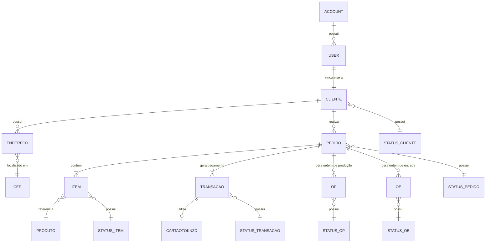

# Central de Modelagem e Arquitetura — OSDroupa

Bem-vindo à central de documentação e modelagem do projeto **OSDroupa**. Este guia foi criado para facilitar a navegação e o entendimento de todas as decisões conceituais, de banco de dados e de arquitetura.

---

## 🧭 Onde encontrar cada página de modelagem:

| Camada de Modelagem | Documento / Pasta | O que você encontra |
|---|---|---|
| 📐 **Modelo Conceitual de Domínio** | [`docs/domain-model.md`](./domain-model.md) | As entidades do negócio, suas responsabilidades, atributos e relacionamentos (User, Cliente, Pedido, Produto, Endereço, etc.). |
| 🌐 **Visão Geral e Arquitetura** | [`docs/project-overview.md`](./project-overview.md) | Stack atual, recursos locais, integrações ativas e limites de lançamento. |
| 🗂️ **Estrutura de pastas** | [`docs/project-structure.md`](./project-structure.md) | Responsabilidade de cada diretório e caminhos necessários ao Reflex/Xano. |
| 🗄️ **Modelagem Física do Banco (Xano)** | [`../xano/table/`](../xano/table/) | Os 39 arquivos `.xs` com os schemas físicos das tabelas PostgreSQL no Xano (chaves primárias, estrangeiras e tipos de dados). |
| 🔌 **Endpoints e Regras de Negócio (APIs)** | [`../xano/api/`](../xano/api/) | Grupos de APIs REST (`authentication`, `panela_de_barro`, `members_accounts`, `db_bruno_magno`). |
| 📜 **Especificações Consolidadas** | [`../openspec/specs/`](../openspec/specs/) | As especificações definitivas de comportamento promovidas após a conclusão das Changes ([`auth/spec.md`](../openspec/specs/auth/spec.md), [`cliente/spec.md`](../openspec/specs/cliente/spec.md)). |
| 🔄 **Evolução Incremental (Changes)** | [`../openspec/changes/`](../openspec/changes/) | Uma change ativa consolidada e o histórico preservado em `archive/`. |

---

## 🗺️ Diagrama de Entidades e Relacionamentos do Domínio

---

## 📊 Matriz de Rastreabilidade (Conceito ➔ Banco Xano ➔ Frontend Reflex)

| Conceito de Negócio | Tabela no Xano (`xano/table/`) | Endpoints Principais (`xano/api/`) | Telas / Estados no Reflex (`OSDroupa/`) |
|---|---|---|---|
| **Usuário e Acesso** | `user.xs`, `account.xs` | `POST /auth/signup`, `POST /auth/login`, `GET /auth/me` | `AuthState`, rotas `/` e `/cadastro` |
| **Perfil do Cliente** | `cliente.xs`, `status_cliente.xs` | `POST cadastraCliente`, `GET buscaCliente` | Formulário de Cadastro, Perfil |
| **Endereços e CEP** | `endereco.xs`, `cep.xs`, `tipoendereco.xs` | `busca_cep`, `upsert_cep`, `salva_endereco`, `marcar_endereco_padrao` | `AddressState`, formulário de endereço |
| **Roupas e Catálogo** | `produto.xs` | `produto_GET`, `produto_POST` | Arara interativa, Vitrine de Looks |
| **Pedidos e Compras** | `pedido.xs`, `item.xs`, `status_pedido.xs` | `pedido_GET`, `pedido_POST`, `item_GET` | Checkout e Histórico de Pedidos |
| **Produção e Logística** | `op.xs`, `oe.xs`, `status_op.xs`, `status_oe.xs` | `op_GET`, `oe_GET` | Painel de confecção sob demanda |
| **Pagamentos Mercado Pago** | Orders API e webhook no backend SQLite | `/api/webhooks/mercadopago` | Configuração e itens pendentes em [`payment-and-launch-checklist.md`](./payment-and-launch-checklist.md); rascunhos Xano Asaas estão bloqueados localmente |
| **Guarda-Roupa Inteligente** | `agent_conversation.xs`, `agent_message.xs` | `xano_example_agent.xs` | IA do Look do Dia e arara RFID / IoT |
